<p align="center">
  
</p>

<p align="center">
  <a href="https://nextjs.org"></a>
  <a href="https://react.dev"></a>
  <a href="https://www.typescriptlang.org"></a>
  <a href="https://neon.tech"></a>
  <a href="https://vercel.com"></a>
</p>

<p align="center">
  <b>Gerenciador financeiro pessoal, mobile-first, com sincronização automática via Open Finance.</b><br>
  Saldos, faturas, lançamentos e relatórios dos seus bancos num app instalável, só seu.
</p>

<p align="center">
  <a href="#-telas">Telas</a> ·
  <a href="#-recursos">Recursos</a> ·
  <a href="#-como-funciona">Como funciona</a> ·
  <a href="#-começando-local">Começando</a> ·
  <a href="#-deploy-vercel--neon">Deploy</a> ·
  <a href="#-segurança">Segurança</a>
</p>

---

## 🎯 O que é

O **Prumo** junta num lugar só o que está espalhado em vários apps de banco: saldos, faturas de cartão,
lançamentos, investimentos e uma projeção de caixa. Os dados chegam sozinhos pelo **Open Finance**
(via [Pluggy](https://pluggy.ai) e o [Meu Pluggy](https://meu.pluggy.ai)) e você só precisa classificar o que
o app não souber sozinho, com um toque.

É um app de **um usuário só**: uma instalação, um banco de dados, uma pessoa. O nome vem do **fio de prumo**,
a ferramenta que mostra o que está alinhado. É essa a ideia: suas contas, no prumo.

## 📸 Telas

> As telas do app usam **dados fictícios**.

**Página inicial** (pública, em `/`): apresenta o app e leva ao login pelo botão "Entrar". Quem já está logado vai direto para o app.

<p align="center">
  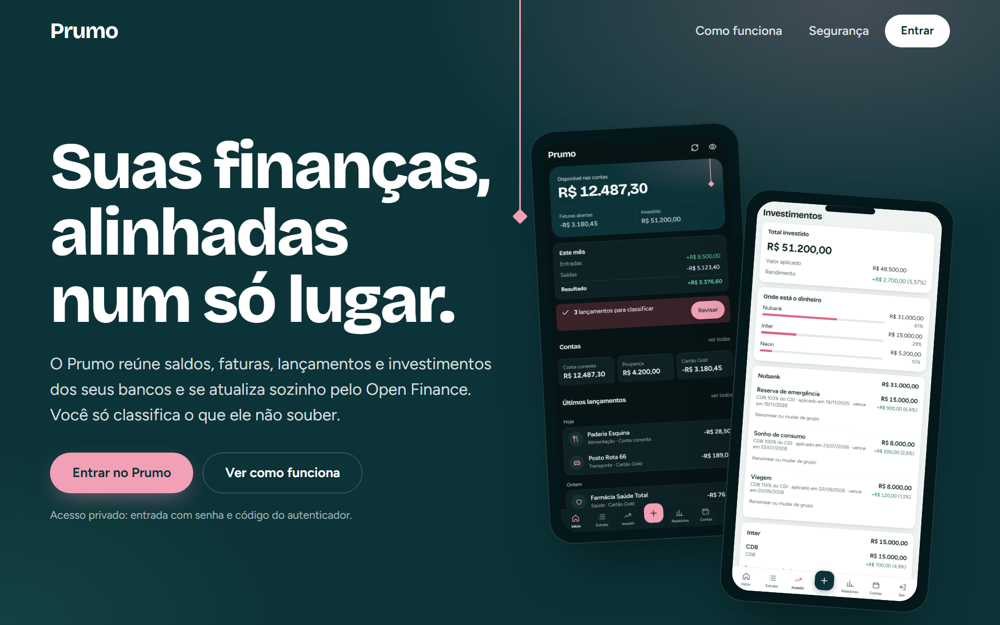
  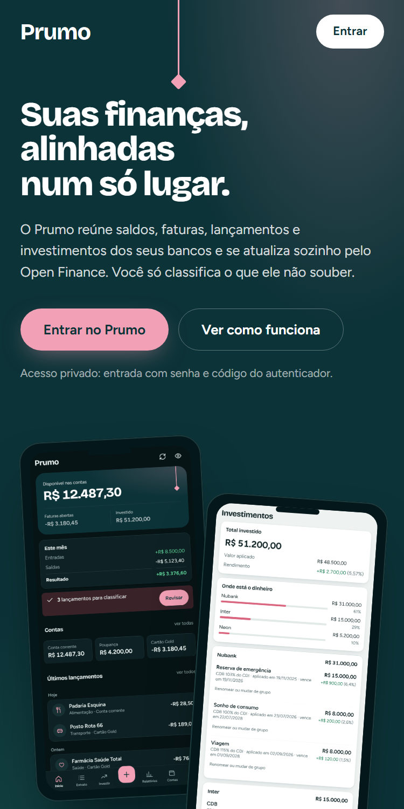
</p>

**Entrada**, no desktop e no celular, nos temas claro e escuro:

<p align="center">
  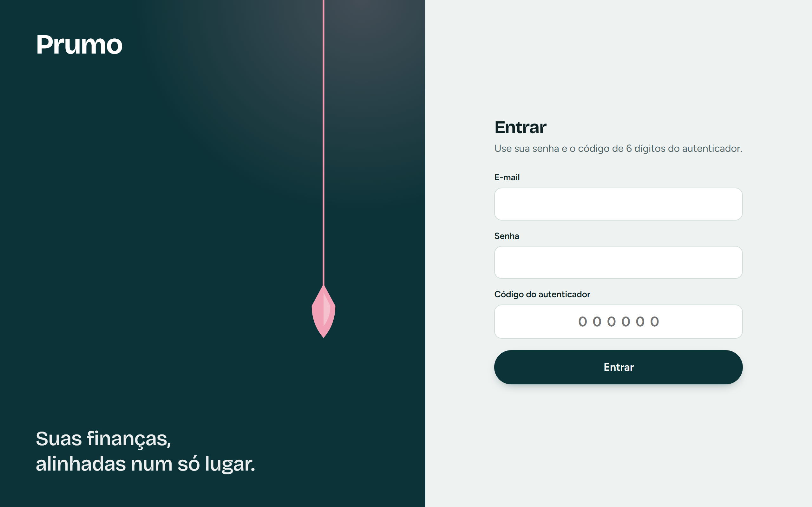
  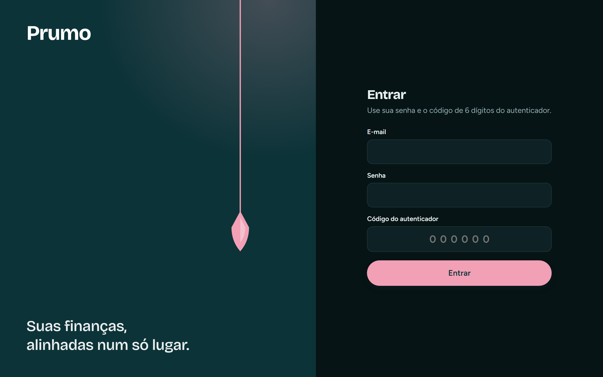
</p>

<p align="center">
  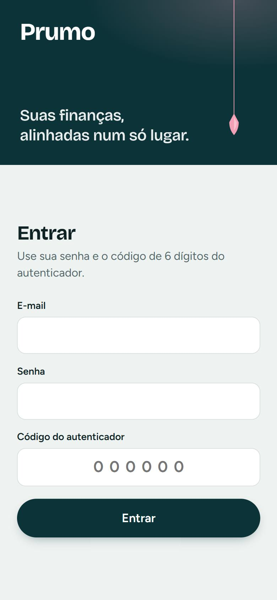
  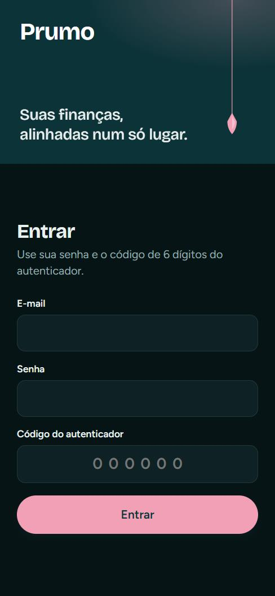
</p>

**Início e lançamentos**: saldo, resultado do mês, contas e o extrato agrupado por dia.

<p align="center">
  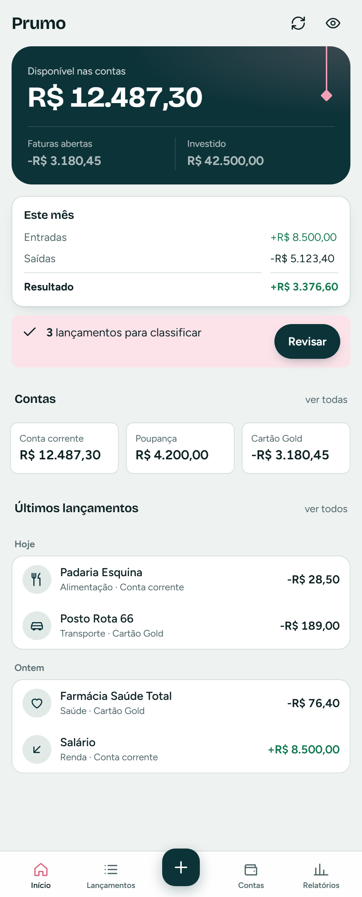
  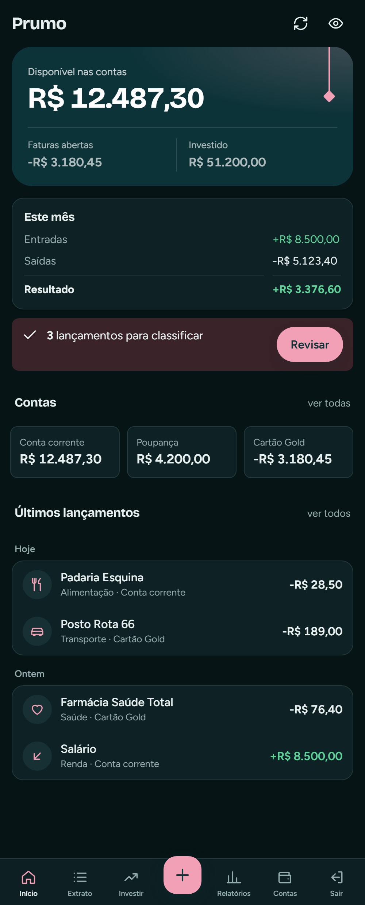
  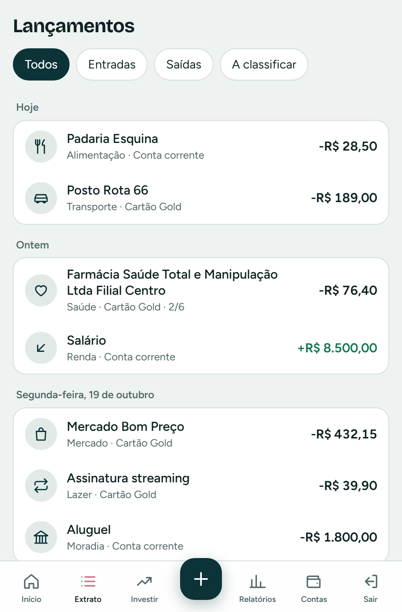
  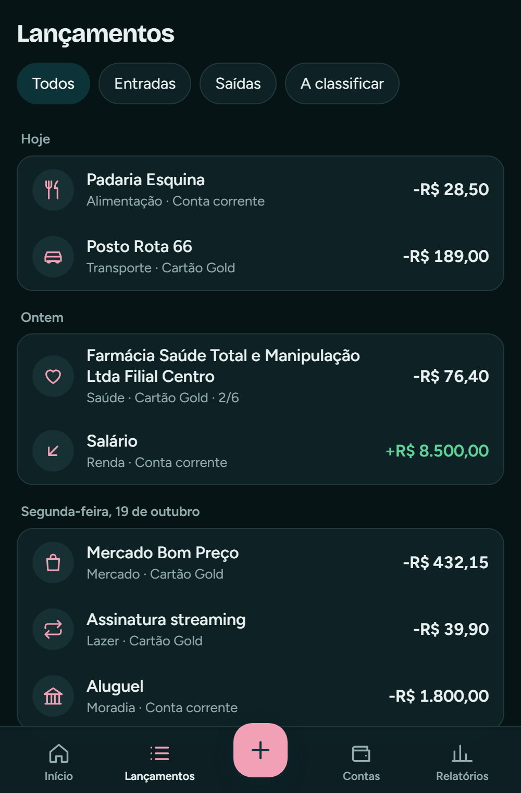
</p>

**Investir**: os investimentos agrupados por instituição, com taxa, aplicação e vencimento, e nomes que você escolhe. **Importar**: extrato OFX, CSV ou planilha do Excel.

<p align="center">
  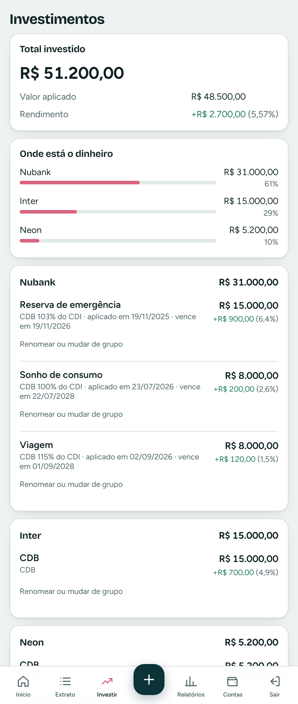
  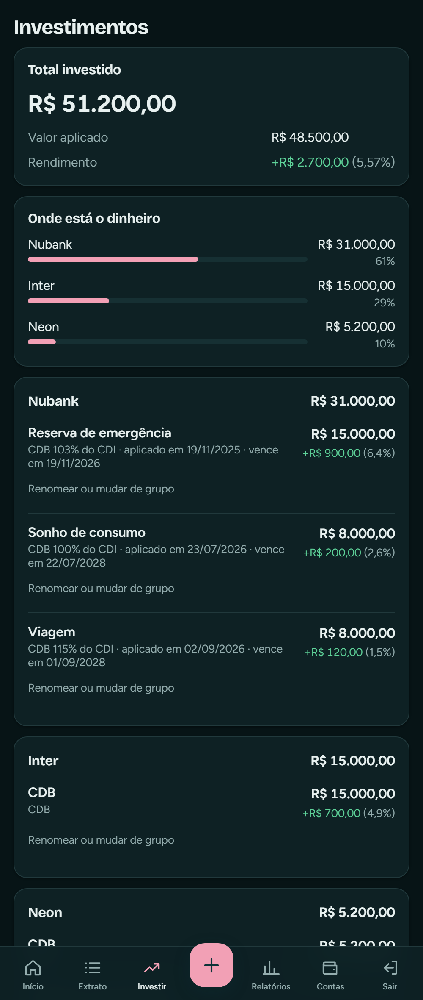
  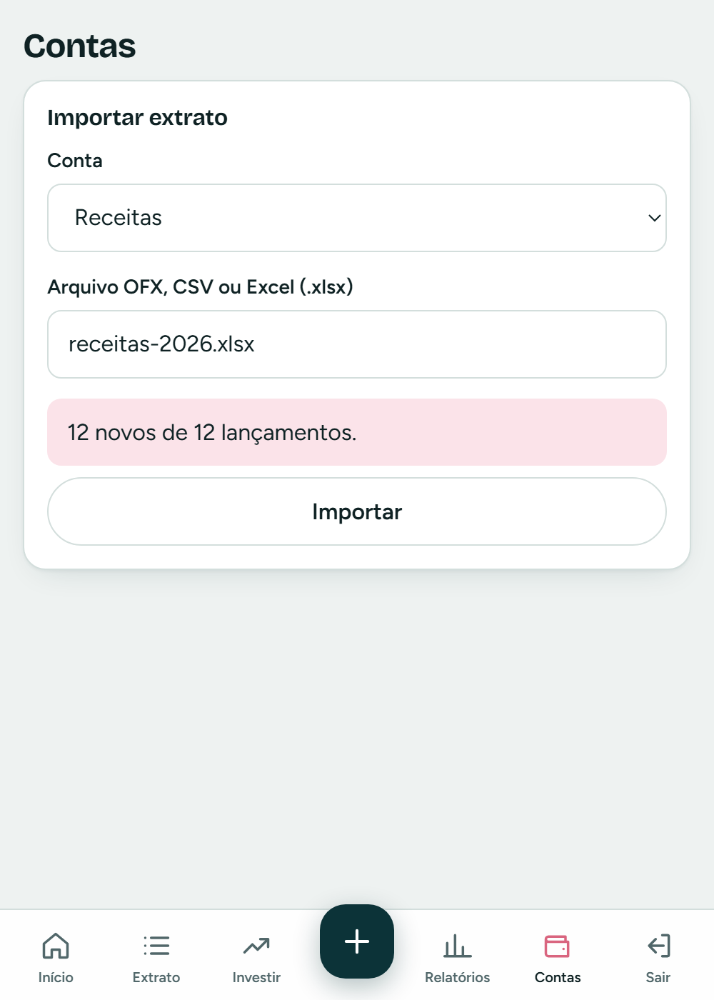
  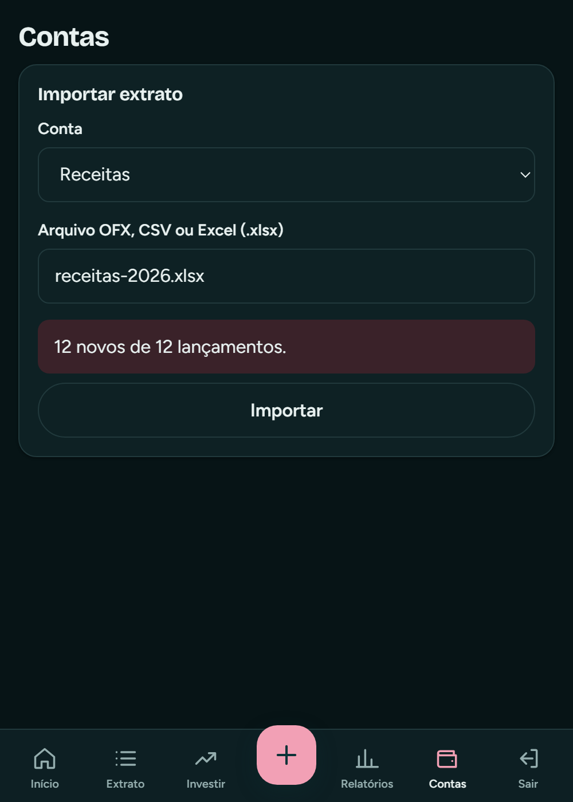
</p>

## ✨ Recursos

**Visão geral**
- Saldo disponível, faturas abertas e total investido num cartão só
- Resultado do mês (entradas, saídas e saldo) e os últimos lançamentos
- **Modo privacidade**: borra os valores para abrir o app em público
- Tema claro e escuro, que seguem o sistema

**Lançamentos**
- Busca e filtros, agrupados por dia
- Lançamento manual rápido, para dinheiro em espécie e bancos fora do Open Finance
- Importação de extratos **OFX, CSV e planilhas do Excel (.xlsx)**, inclusive o formato de conta e de cartão do Nubank.
  A planilha só precisa de colunas de data, descrição e valor: o cabeçalho pode estar abaixo de um título, e
  linhas de total são ignoradas
- **Auto-categorização**: regras, dicionário e histórico por similaridade
- **Conciliação simples**: fila "A classificar" de um toque e junção do lançamento manual com o do banco
- Pareamento automático de transferências entre contas suas

**Investimentos**
- Agrupados por **instituição** (Nubank, Inter…), com o total e a participação de cada uma
- Cada CDB mostra **taxa, data de aplicação e vencimento** (ex.: "CDB 103% do CDI"), o que distingue títulos que a
  Pluggy devolve com o mesmo nome
- **Renomear e reagrupar** direto na lista ("Reserva de emergência", "Sonho de consumo"). A sincronização nunca
  sobrescreve o que você escreveu
- Evolução da carteira, rendimento sobre o valor aplicado e últimos aportes e resgates

**Análises**
- DRE do mês e patrimônio líquido
- Rentabilidade dos investimentos (TWR) contra o **CDI**
- Recorrências detectadas e **projeção de saldo** para 3, 6 e 12 meses

**Sincronização**
- Por **webhook** da Pluggy, em tempo quase real
- Rotina diária de segurança, para o caso de algum webhook se perder
- Alerta quando uma conexão precisa de atenção e antes de a autorização do Meu Pluggy vencer

**Página inicial**
- Landing pública em `/`, com o botão **Entrar** que leva ao `/login`. Logado, `/` redireciona para `/inicio`
- Imagem de compartilhamento (Open Graph) para quando o link for colado em mensagens

**App**
- **PWA** instalável no Android e no iOS: ícone, tela cheia e tela offline
- Layout pensado para o polegar: navegação inferior com sete abas (Início, Extrato, Investir, Novo, Relatórios,
  Contas e Sair) no celular e trilho lateral no desktop
- Página **Sair** com "sair deste aparelho" e "sair de todos os aparelhos"

## 🧭 Como funciona

> **Rotas:** `/` é a página inicial pública; `/login` pede senha e código do autenticador; o app vive em `/inicio` e nas telas seguintes. Quem tenta abrir uma tela do app sem estar logado cai no `/login`.

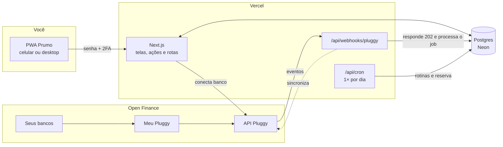

**Fila de jobs dentro do Postgres** (sem Redis): cada evento vira um job, com tentativas e espera crescente
quando falha. Os jobs são pegos com `SKIP LOCKED`, então mais de um processo pode trabalhar sem disputa.

**Dois modos de rodar o mesmo código:**

| Modo | `WORKER_ENABLED` | Quem processa a fila |
| --- | --- | --- |
| Servidor contínuo (Docker, Railway, Fly) | `true` | Um worker dentro do próprio processo, a cada 2 s |
| **Serverless (Vercel)** | `false` | O **webhook** processa o job na hora, depois de responder, e o **cron diário** retoma o que falhou |

Na Vercel, o webhook responde `202` em milissegundos (a Pluggy exige resposta em até 10 s) e usa `after()`
do Next.js para executar o job em seguida, sem prender a resposta.

## 🧰 Stack

| Camada | Tecnologia |
| --- | --- |
| App | Next.js 16 (App Router, Server Actions), React 19, TypeScript |
| Estilo | CSS puro com tokens, sem biblioteca de UI. Fontes Bricolage Grotesque e Figtree |
| Banco | PostgreSQL 16+ (Neon), driver [`postgres`](https://github.com/porsager/postgres), SQL escrito à mão em `db/queries/` |
| Open Finance | [Pluggy](https://pluggy.ai) + Meu Pluggy, cliente HTTP próprio (só `fetch`) |
| Autenticação | Senha (scrypt) + 2FA TOTP (RFC 6238), sessões revogáveis, sem dependências |
| Hospedagem | Vercel (Hobby) + Neon (Free) |
| Testes | `node:test`, com TypeScript direto no Node 22.18+ |

Quase tudo que poderia ser biblioteca é código próprio e pequeno: TOTP, criptografia de campos,
cliente da Pluggy, fila de jobs, importadores OFX/CSV e o cálculo de XIRR. O app instala **cinco**
dependências de runtime.

## 🚀 Começando (local)

Requisitos: **Node 22.18+**, **pnpm** e **Postgres 16+**.

```bash
pnpm install
cp .env.example .env.local          # preencha as variáveis (veja a tabela abaixo)
set -a; source .env.local; set +a   # no PowerShell: carregue as variáveis do arquivo
pnpm db:migrate                     # cria as tabelas e o seed de categorias
pnpm user:create voce@email.com     # senha + 2FA no seu app autenticador
pnpm dev                            # http://localhost:3000
```

### Scripts

| Comando | O que faz |
| --- | --- |
| `pnpm dev` | Servidor de desenvolvimento |
| `pnpm build` · `pnpm start` | Build de produção e execução (modo standalone, para Docker) |
| `pnpm typecheck` | Checagem de tipos |
| `pnpm test` | Testes de unidade |
| `pnpm test:db` | Testes de SQL, num banco descartável (`DATABASE_URL=… pnpm test:db`) |
| `pnpm db:migrate` | Aplica as migrações em `db/migrations/` e o seed |
| `pnpm user:create <e-mail>` | Cria (ou redefine) o usuário e ativa o 2FA |
| `pnpm webhook:register` | Registra o webhook na Pluggy, com o cabeçalho secreto |
| `pnpm icons` | Gera os PNGs do ícone a partir de `public/icon.svg` (ImageMagick) |

## 🔐 Variáveis de ambiente

Copie [`.env.example`](.env.example) para `.env.local`. **Nunca versione o arquivo real.**

| Variável | Para quê | Como obter |
| --- | --- | --- |
| `DATABASE_URL` | Conexão com o Postgres | No Neon, use o endpoint *pooled* com `?sslmode=require` |
| `APP_URL` | URL pública do app (`https` em produção) | `https://<seu-projeto>.vercel.app` |
| `PLUGGY_CLIENT_ID` · `PLUGGY_CLIENT_SECRET` | Credenciais da API | [dashboard.pluggy.ai](https://dashboard.pluggy.ai) → Applications. O *secret* aparece uma vez só |
| `PLUGGY_WEBHOOK_SECRET` | Segredo enviado em cada webhook | `openssl rand -hex 32` |
| `FIELD_ENCRYPTION_KEY` | Chave AES-256 dos campos cifrados (segredo do 2FA) | `openssl rand -base64 32`. **Perdeu? Refaça o 2FA** |
| `WORKER_ENABLED` | `false` em hospedagem serverless | `true` por padrão |
| `CRON_SECRET` | Protege `/api/cron` (só na Vercel) | `openssl rand -hex 32` |

## 🚢 Deploy: Vercel + Neon

Cabe nos planos gratuitos: **Vercel Hobby** e **Neon Free**.

1. **Banco.** No [Neon](https://neon.tech), crie um projeto (ou um banco novo num projeto existente) e copie a
   *connection string* **pooled**. Com ela no ambiente, rode `pnpm db:migrate` uma vez.
2. **Código.** Suba o repositório no GitHub (privado, de preferência).
3. **Vercel.** Em *New Project*, importe o repositório e cadastre as variáveis da tabela acima, com
   `WORKER_ENABLED=false`. O script `vercel-build` aplica as migrações a cada deploy de **produção**.
4. **Usuário.** Com o `.env.local` apontando para o banco de produção: `pnpm user:create voce@email.com`.
5. **Webhook.** Com o app no ar e o `APP_URL` certo: `pnpm webhook:register`. O comando recria o webhook, então
   pode ser repetido sem medo.
6. **Cron.** O [`vercel.json`](vercel.json) já agenda `/api/cron` uma vez por dia (13:00 UTC, perto das 10h de
   Brasília). No plano Hobby o horário exato varia dentro da hora.

<details>
<summary><b>Notas de quem já passou por isso</b></summary>

- **Pooler do Neon:** o pgbouncer em modo transação não garante *prepared statements*, por isso o driver roda com
  `prepare: false`.
- **Parâmetros `jsonb`:** o driver serializa objetos sozinho. Passar `JSON.stringify(...)` faz o Postgres receber uma
  *string* JSON, e funções como `jsonb_to_recordset` falham. Use o helper `json()` de `src/db/index.ts`.
- **Duração das funções:** webhook e cron declaram `maxDuration = 300`, o limite do Hobby com Fluid Compute.
- **Domínio:** nomes curtos como `prumo.vercel.app` costumam estar tomados. Use o domínio que a Vercel atribuir
  ao projeto no `APP_URL`.
- **Docker:** o `output: 'standalone'` do Next só é usado fora da Vercel (veja `next.config.ts`).
</details>

## 🏦 Conectando seus bancos

Para **uso pessoal e gratuito**:

1. Crie conta no **[Meu Pluggy](https://meu.pluggy.ai)** e conecte seus bancos lá (cada banco autoriza uma vez).
2. Entre no **[dashboard da Pluggy](https://dashboard.pluggy.ai)** com a mesma conta e crie uma aplicação. Copie o
   Client ID e o Client Secret.
3. Em *Customization → Connectors*, deixe o **MeuPluggy** ligado.
4. No app, **Contas → Conectar banco** e escolha **MeuPluggy** no widget.

> [!IMPORTANT]
> Uma aplicação da Pluggy em modo de **teste** (*trial*) só conecta o banco de testes (*Pluggy Bank*). O widget
> avisa com "Contas de teste só podem conectar conectores sandbox". Para conectar contas reais, **solicite acesso a
> dados reais** à Pluggy e aguarde a aprovação.

Limites do uso pessoal: até **5 conexões** e **sem uso comercial**. A autorização do Meu Pluggy vale **1 ano**; o app
avisa 30 dias antes e o botão **Renovar** refaz a autorização.

## 🔒 Segurança

Os dados são financeiros, então o básico foi levado a sério:

- **Login:** senha com **scrypt** e **2FA obrigatório** por TOTP. O código só vale **uma vez**, mesmo dentro da
  janela de 30 s.
- **Tentativas:** limite por IP e por conta (cinco erros de código com a senha certa travam por 15 minutos, em
  qualquer IP). O freio global só atrasa, para ninguém trancar o dono do lado de fora. O IP vem de fonte confiável
  (`x-real-ip` na Vercel).
- **Sessões:** o token fica só no cookie. No banco vai apenas o hash, e as sessões podem ser revogadas.
- **Campos sensíveis:** o segredo do 2FA é cifrado com **AES-256-GCM** antes de ir ao banco.
- **Webhook:** não há assinatura HMAC na Pluggy, então a autenticação é um cabeçalho secreto, comparado em tempo
  constante. Eventos repetidos são ignorados pelo `eventId`.
- **Uploads:** só com sessão, até 5 MB. O leitor de `.xlsx` é próprio e tem tetos de descompactação, linhas, colunas
  e células, além de varrer o XML em tempo linear. Importar o mesmo arquivo duas vezes não duplica lançamentos.
- **Cabeçalhos HTTP:** CSP restrita (só `*.pluggy.ai` para o widget), HSTS, `X-Frame-Options: DENY` e
  `Permissions-Policy` fechada.
- **Segredos:** nada de credenciais no repositório. O `.env.local` está no `.gitignore`.

Achou algo? Abra uma *issue* sem colar dados reais.

## 🧪 Testes

```bash
pnpm typecheck
pnpm test            # unidade: TOTP, senha, criptografia, dinheiro, datas, OFX/CSV/XLSX, investimentos, XIRR, projeção, cliente e webhook da Pluggy
pnpm test:db         # SQL: cenário de ponta a ponta do banco (seed idempotente, normalização, contas…), num Postgres descartável
```

## 📁 Estrutura

```
.
├── db/
│   ├── migrations/      # esquema do banco, em ordem (001 a 005 até aqui)
│   ├── queries/         # SQL de negócio, um arquivo por consulta
│   ├── seed.sql         # 38 categorias e as regras de sistema
│   └── test/            # cenários SQL
├── scripts/             # migrate, create-user, register-webhook, make-icons
├── public/              # ícones, imagens da landing, service worker, tela offline
├── src/
│   ├── app/             # landing (/), telas do app (/inicio, lançamentos, investimentos…), rotas de API e login
│   ├── components/      # Amount, TxList, BottomNav, ConnectBank, ForecastChart…
│   ├── db/              # conexão e portas do banco (sync, webhook, fila)
│   ├── domain/          # regras puras: OFX, CSV, XLSX, agrupamento de investimentos, XIRR, projeção
│   ├── jobs/            # worker, handlers e agendamentos
│   ├── lib/             # sessão, TOTP, senha, criptografia, dinheiro, datas
│   └── pluggy/          # cliente, tipos, mapeamento e sincronização
├── test/                # testes de unidade
├── vercel.json          # cron diário
└── Dockerfile           # alternativa à Vercel: um container só
```

## 🗺️ Próximos passos

- [x] Acesso a dados reais na Pluggy (os investimentos já sincronizam com bancos de verdade)
- [x] Investimentos agrupados por instituição e importação de planilhas do Excel
- [x] Landing page pública como porta de entrada

Ideias para depois: metas e orçamento por categoria, alertas de vencimento de fatura e exportação dos dados.

---

<p align="center">
  <sub>Projeto pessoal, feito com cuidado. O fio de prumo no topo é o que dá nome ao app.</sub>
</p>
